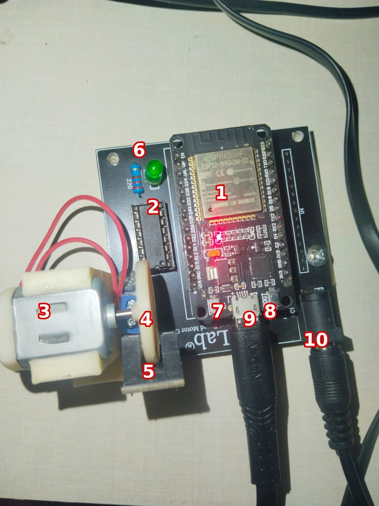
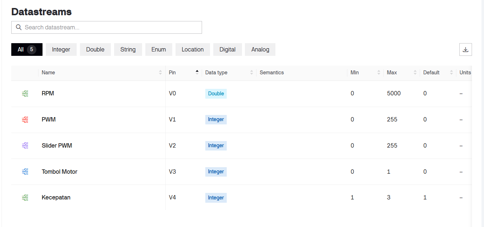
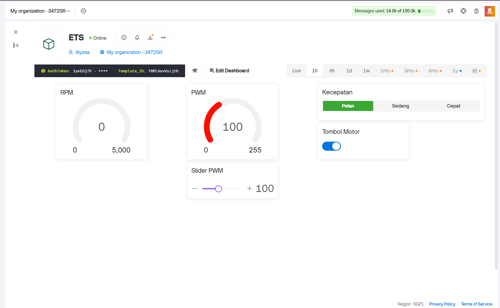
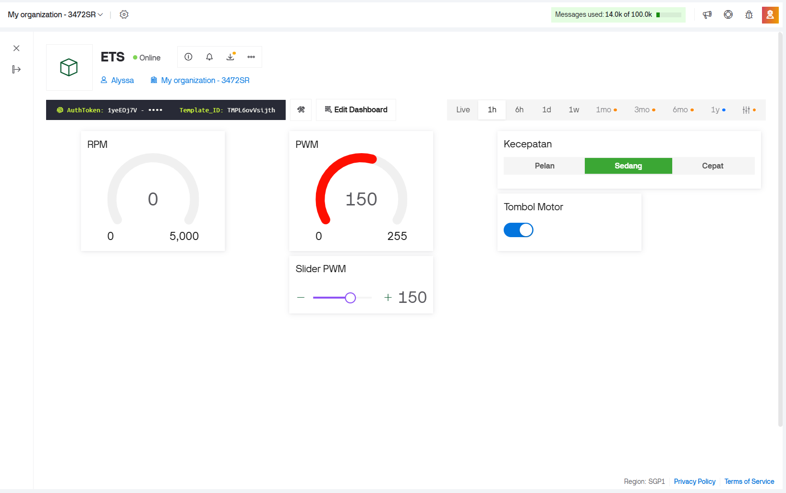
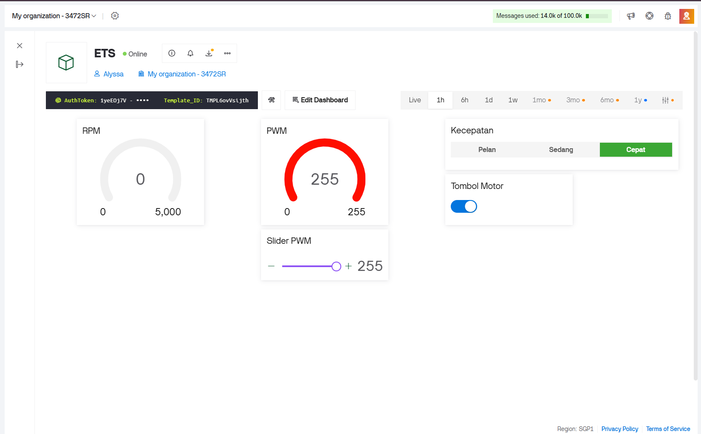
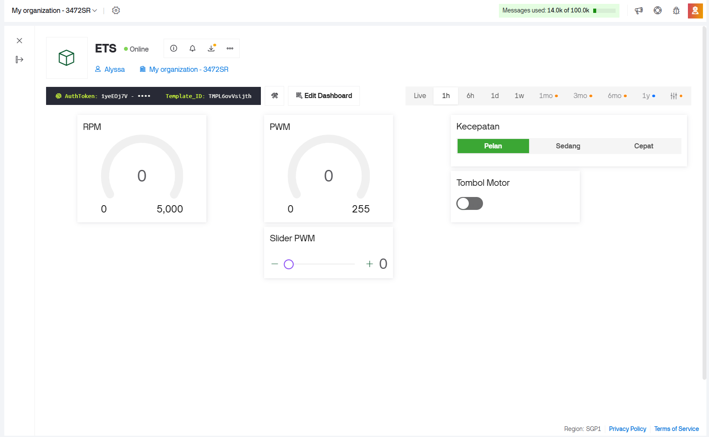

## Daftar Isi

- [Gambaran Umum](#gambaran-umum)
- [Perangkat yang Digunakan](#perangkat-yang-digunakan)
- [Eksperimen: kode modifikasi](#eksperimen-kode-modifikasi)
- [Kesimpulan](#kesimpulan)

## Gambaran Umum
Pada Modul 1 perintah ke motor diketik di Serial Monitor, dan pada Modul 2 dikirim dari Python. Keduanya memerlukan kabel USB ke laptop. Modul 3 melepas ketergantungan itu: ESP32 tersambung ke WiFi dan ke Blynk IoT, sehingga motor dapat dikendalikan dari dasbor di ponsel atau browser. Modul ini juga mulai memakai sensor celah (pin 13) yang pada Modul 1 baru disiapkan. ESP32 menghitung RPM dari pulsa piringan, lalu mengirimnya ke dasbor setiap 1 detik.

Tujuan praktikum:
1. Menghubungkan ESP32 ke WiFi dan Blynk IoT, lalu mengendalikan motor dari dasbor (slider PWM dan tombol ON/OFF).
2. Memahami cara ESP32 menghitung RPM dari sensor celah dan menampilkannya di dasbor.
3. Memahami pembagian tugas antara fungsi `BLYNK_WRITE` (perintah dari dasbor), `applyMotor` (menerapkan PWM), dan `BlynkTimer` (kirim data berkala).
4. Memodifikasi sketch agar mendukung tiga level kecepatan dari dasbor, dengan frekuensi PWM dan dorongan awal dari Modul 1.

## Perangkat yang Digunakan

  
   <b>Gambar 1.</b> Kit iMCLab

| No | Bagian | Peran |
|---|---|---|
| 1 | ESP32 DevKit (modul ESP32-WROOM-32) | Pengendali, terhubung ke WiFi dan Blynk, menghasilkan sinyal arah serta PWM, dan menghitung RPM |
| 2 | IC driver motor 16 pin | Menyalurkan daya dari adaptor ke motor sesuai sinyal ESP32 |
| 3 | Motor DC dengan rumah putih cetak 3D | Aktuator yang diamati |
| 4 | Piringan putih pada poros | Penanda putaran yang melewati celah sensor |
| 5 | Modul sensor celah (*slot*) | Mendeteksi putaran piringan, keluarannya dibaca ESP32 di pin 13 untuk menghitung RPM |
| 6 | LED hijau dan resistor | Indikator pada papan |
| 7 | Tombol EN | Mereset ESP32 |
| 8 | Tombol BOOT | Ditahan saat unggah program saat proses macet di `Connecting...` |
| 9 | Konektor micro-USB | Daya dan data ke laptop (unggah program dan Serial Monitor) |
| 10 | Jack DC | Catu daya adaptor |

Pada ESP32 sendiri ada dua LED kecil: merah sebagai penanda daya, dan biru yang terhubung ke pin 2. Pada sketch Modul 3, LED biru menyala selama duty cycle lebih dari 0, jadi tetap menandakan motor sedang diberi daya.

| Perangkat lunak | Keterangan |
|---|---|
| Arduino IDE | versi 2.3.1 |
| Board | DOIT ESP32 DEVKIT V1 |
| Pustaka | `WiFi.h` dan `BlynkSimpleEsp32.h` (Blynk) |
| Layanan | Blynk IoT (template dan dasbor di Blynk Console/aplikasi) |
| Sketch di ESP32 | `imclab_Blynk_v3.ino` (modifikasi), dibandingkan dengan `imclab_Blynk_kelas.ino` (kode asli) |
| Port | COM6 |
| Serial Monitor | 115200 baud, *line ending* Newline |

### Datastream Blynk

Datastream yang dibuat hanya V0 sampai V4. V0 sampai V3 juga dipakai oleh kode asli, V4 hanya oleh kode modifikasi.

  
   <b>Gambar 2.</b> Datastream pada template Blynk

| Virtual pin | Nama | Tipe | Rentang (bawaan) | Widget | Arah | Dipakai oleh |
|---|---|---|---|---|---|---|
| V0 | RPM | Double | 0 sampai 5000 (0) | *Gauge* | ESP32 ke Blynk | kode asli dan modifikasi |
| V1 | PWM | Integer | 0 sampai 255 (0) | *Gauge* | ESP32 ke Blynk | kode asli dan modifikasi |
| V2 | Slider PWM | Integer | 0 sampai 255 (0) | *Slider* | dua arah | kode asli dan modifikasi |
| V3 | Tombol Motor | Integer | 0 sampai 1 (0) | *Switch* | dua arah | kode asli dan modifikasi |
| V4 | Kecepatan | Integer | 1 sampai 3 (1) | *Segmented switch* (Pelan, Sedang, Cepat) | dua arah | kode modifikasi |

Sketch modifikasi juga menulis teks status ke V5 (`virtualWrite(V5, ...)`), tetapi datastream V5 belum dibuat di template, jadi teks itu tidak tampil di dasbor.

### Kode asli dan kode modifikasi

| Aspek | Kode asli | Kode modifikasi |
|---|---|---|
| Perintah serial | 1, 0, +, -, `PWM:n`, R | ditambah 2, 3, 4 |
| Kontrol dari Blynk | slider (V2), tombol (V3) | ditambah pilihan level (V4); teks status ke V5 dikirim tetapi datastream-nya belum dibuat |
| Frekuensi PWM | 30000 Hz | 5000 Hz |
| Duty saat ON | angka `200` ditulis langsung (baris 199 dan 315) | konstanta `DUTY_ON` = 205 |
| Level kecepatan | tidak ada | `LEVEL_DUTY` = {0, 100, 150, 255} dan `LEVEL_NAMA`, diatur oleh `setLevel()` |
| Dorongan awal | tidak ada | duty 255 selama 60 ms saat motor diam dan duty target kurang dari 255 (`motorRunning`) |
| Sinkronisasi saat tersambung | V2, V3 | ditambah V4 |
| Pesan saat boot | daftar perintah dasar | daftar perintah lengkap beserta duty tiap level |

Pin yang dipakai sama pada keduanya: LED 2, motor 27 dan 26, enable 12, sensor RPM 13. Perhitungan RPM (`hitungRPM`), ISR sensor, dan pengiriman data berkala (`kirimKeBlynk`) tidak diubah.

## Eksperimen: kode modifikasi

<table align="center">
  <tr>
    <td align="center"> Pelan, PWM 100</td>
    <td align="center"> Sedang, PWM 150</td>
    <td align="center"> Cepat, PWM 255</td>
  </tr>
</table>

<b>Gambar 3.</b> Dasbor Blynk saat level kecepatan dipilih dari V4: slider PWM, gauge PWM, dan tombol motor ikut berubah

### Apa yang diubah dan alasannya

1. **Tiga level kecepatan.** `LEVEL_DUTY` memetakan level 1, 2, 3 ke duty 100, 150, 255. `setLevel()` menerapkannya, dipanggil oleh perintah serial `2`, `3`, `4` dan oleh pilihan level V4 di dasbor. Duty-nya sama dengan sketch modifikasi Modul 1.
2. **Pilihan level mengikuti duty.** `levelDariDuty()` mencocokkan duty dengan level 1 sampai 3, dan `applyMotor()` menulis hasilnya ke V4 sehingga pilihan Pelan/Sedang/Cepat di dasbor ikut berubah ketika duty diatur dari serial. `applyMotor()` juga mengirim teks status (`OFF`, `PELAN`, `SEDANG`, `CEPAT`, `MANUAL`) ke V5, tetapi datastream V5 belum dibuat sehingga teks ini tidak tampil.
3. **Frekuensi PWM 30000 Hz menjadi 5000 Hz.** Perubahan yang sama dengan Modul 1.
4. **Dorongan awal pada `applyMotor()`.** Jika motor diam (`motorRunning` bernilai false) dan duty target di antara 1 dan 254, motor diberi duty 255 selama 60 ms (`delay(kickTime)`), lalu turun ke duty target. Karena ditaruh di `applyMotor()`, dorongan ini berlaku untuk semua jalur: perintah serial, slider, tombol, dan level.
5. **Konstanta `DUTY_ON` = 205.** Menggantikan angka `200` yang tertulis langsung, sehingga duty ON sama dengan Modul 1 dan 2. Perintah serial `1` kini selalu mengatur duty ke 205.
6. **Sinkronisasi V4 saat tersambung.** `BLYNK_CONNECTED()` ditambah `syncVirtual(V4)` supaya pilihan level di dasbor mengikuti kondisi terakhir.

### Hasil

| Perintah | Sumber | Duty | Balasan Serial Monitor | Respons motor | RPM (V0) |
|---|---|---|---|---|---|
| `2` | serial | 100 | `Motor PELAN \| PWM=100 \| RPM=…` | Berputar pelan | 0 |
| `3` | serial | 150 | `Motor SEDANG \| PWM=150 \| RPM=…` | Berputar cukup pelan | 0 |
| `1` | serial | 205 | `Motor ON \| PWM=205 \| RPM=…` | Berputar cukup kencang | 0 |
| `4` | serial | 255 | `Motor CEPAT \| PWM=255 \| RPM=…` | Berputar kencang | 0 |
| `0` | serial | 0 | `Motor OFF` | Motor berhenti | 0 |
| Pelan | V4 | 100 | `Level dari Blynk = PELAN (duty 100)` | Berputar pelan | 0 pada Gambar 3 |
| Sedang | V4 | 150 | `Level dari Blynk = SEDANG (duty 150)` | Berputar cukup pelan | 0 pada Gambar 3 |
| Cepat | V4 | 255 | `Level dari Blynk = CEPAT (duty 255)` | Berputar kencang | 0 pada Gambar 3 |

Balasan ESP32 berikut terekam pada `image/serial_monitor_blynk.png`.

<table align="center">
  <tr>
    <td align="center"> Online, motor OFF</td>
  </tr>
</table>

<b>Gambar 4.</b>

### Catatan: RPM tidak terdeteksi

RPM tetap 0 pada semua level (Gambar 3), padahal motor berputar. Sketch RPM milik teman yang sudah berhasil membaca RPM pada kitnya juga memberi hasil 0 ketika dijalankan pada kit dan laptop yang dipakai di praktikum ini. Karena sketch yang terbukti bekerja pun gagal, penyebabnya kemungkinan bukan di kode `imclab_Blynk_v3.ino`.

### Analisis

- **Pilihan level hanya diperbarui saat duty cocok dengan level.** `levelDariDuty()` hanya mengenali duty 100, 150, dan 255. Pada duty lain (misalnya 205 dari perintah `1`, atau slider di posisi bebas) V4 tetap menampilkan level terakhir yang dipilih, dan kode mengirim `MANUAL` ke V5 yang belum punya datastream.
- **Pilihan level tetap tertinggal saat motor OFF.** Pada Gambar 4, motor OFF dan PWM 0, tetapi Pelan masih terpilih. Ini sesuai kode: `applyMotor()` tidak menulis V4 saat duty 0.
- **`1` dan tombol V3 tidak berperilaku sama.** Perintah serial `1` selalu mengatur duty ke 205. Tombol V3 ON hanya mengisi 205 saat duty sedang 0, sama seperti kode asli.
- Saat V4 disinkronkan, `BLYNK_WRITE(V4)` terpanggil dengan nilai tersimpan lalu menjalankan `setLevel()`. Nilai bawaan V4 adalah 1 dan nilainya tidak diubah saat motor OFF (Gambar 4), sehingga motor berpotensi menyala di level Pelan setiap kali ESP32 reset atau tersambung ulang. 
- **RPM tidak terdeteksi.** RPM tetap 0 pada semua level, baik di dasbor maupun di Serial Monitor. Rinciannya ada pada catatan di bawah tabel hasil.
- **Kecepatan seharusnya naik mengikuti duty.** Urutan duty 100, 150, 205, 255 diharapkan memberi RPM yang naik. 
- **`Blynk.begin()` menunggu sampai tersambung.** Pesan `Ready` baru tercetak setelah WiFi dan Blynk tersambung. saat WiFi salah atau tidak tersedia, sketch berhenti di baris itu dan perintah serial tidak diproses.

## Kesimpulan

1. Motor iMCLab berhasil dikendalikan lewat Blynk IoT melalui WiFi: slider V2 mengatur duty cycle, tombol V3 menyalakan dan mematikan motor, dan pilihan level V4 mengubah slider serta gauge PWM. Pengiriman RPM ke V0 setiap 1 detik sudah diprogram, tetapi RPM tidak terdeteksi pada kit yang dipakai, bahkan dengan sketch teman yang berhasil di kit lain, sehingga penyebabnya diduga pada perangkat keras sensor dan bukan pada kode. Serial Monitor tetap dapat dipakai dan keduanya mengendalikan variabel `dutyCycle` yang sama.
2. RPM dihitung dari jumlah pulsa per detik dibagi jumlah lubang piringan, dengan resolusi 30 RPM dan pembaruan tiap 1 detik. 
3. Modifikasi membawa perubahan dari Modul 1 dan 2 ke sketch Blynk: frekuensi PWM 5000 Hz, dorongan awal 60 ms, duty ON 205, tiga level kecepatan (100, 150, 255) lewat perintah `2`, `3`, `4` serta pilihan level V4. 