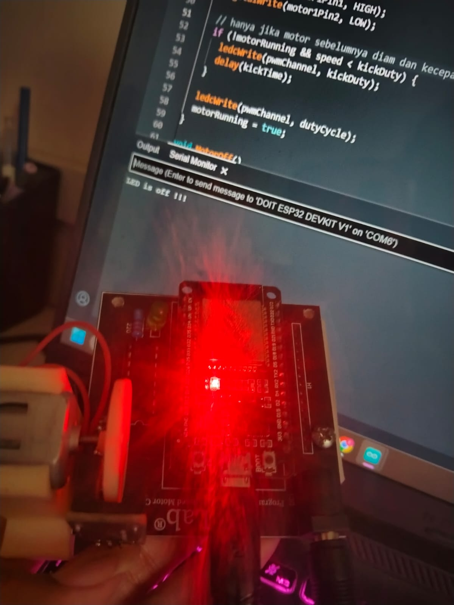
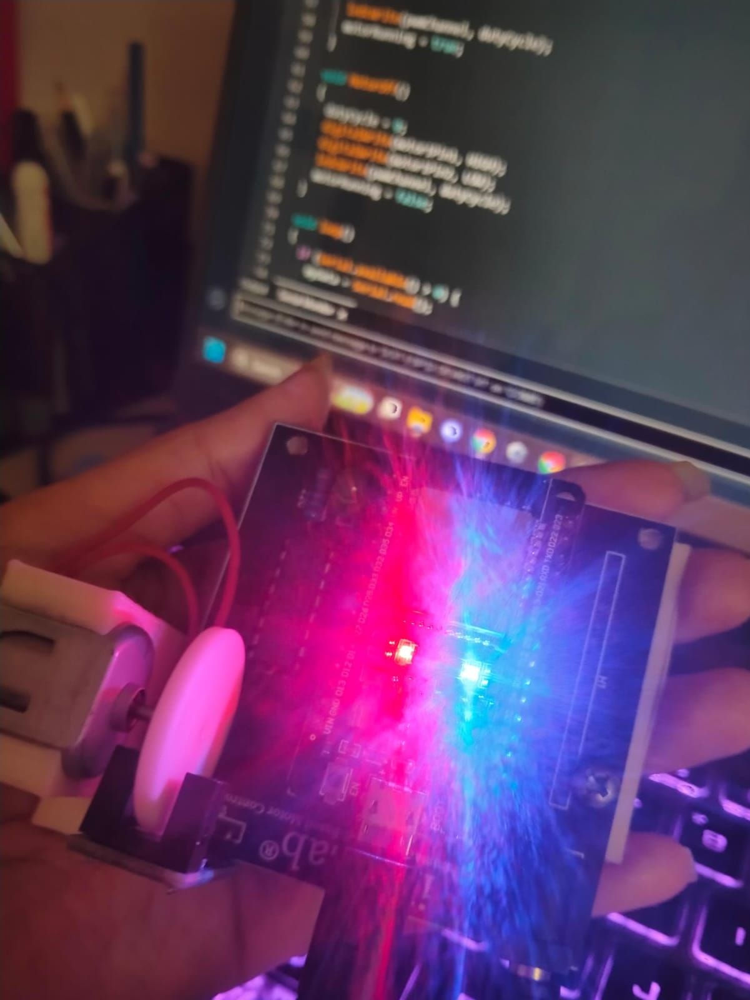

## Daftar Isi

- [Gambaran Umum](#gambaran-umum)
- [Perangkat yang Digunakan](#perangkat-yang-digunakan)
- [Eksperimen A: ON/OFF dengan kode asli](#eksperimen-a-onoff-dengan-kode-asli)
- [Eksperimen B: kode modifikasi](#eksperimen-b-kode-modifikasi)
- [Kesimpulan](#kesimpulan)

## Gambaran Umum
Bagian robot yang menghasilkan gerakan adalah aktuator, dan gerakan itu hanya berguna kalau bisa diperintah dengan tepat. Pada kit iMCLab, perintah berasal dari laptop, diterjemahkan oleh ESP32, lalu diteruskan ke motor melalui IC driver. Modul 1 mempelajari rantai itu dari ujung ke ujung dan mencari tahu apa saja yang bisa membuatnya putus.

Tujuan praktikum:
1. Menyalakan dan mematikan motor dengan karakter dari Serial Monitor.
2. Menunjukkan bahwa komunikasi serial hanya berhasil bila *baud rate* kedua sisi sama.
3. Mengubah kecepatan motor lewat nilai *duty cycle* PWM.
4. Menguji apakah frekuensi PWM yang lebih rendah dan *kick-start* membantu motor mulai berputar pada duty cycle kecil.

## Perangkat yang Digunakan

  
   <b>Gambar 1.</b>

| No | Bagian | Peran |
|---|---|---|
| 1 | ESP32 DevKit (modul ESP32-WROOM-32) | Pengendali, membaca perintah serial dan menghasilkan sinyal arah serta PWM |
| 2 | IC driver motor 16 pin | Menyalurkan daya dari adaptor ke motor sesuai sinyal ESP32 |
| 3 | Motor DC dengan rumah putih cetak 3D | Aktuator yang diamati |
| 4 | Piringan putih pada poros | Penanda putaran yang melewati celah sensor |
| 5 | Modul sensor celah (*slot*) | Mendeteksi putaran piringan |
| 6 | LED hijau dan resistor| Indikator pada papan (tampak menyala sama pada foto ON maupun OFF, jadi bukan penanda perintah) |
| 7 | Tombol EN | Mereset ESP32 |
| 8 | Tombol BOOT | Ditahan saat unggah program bila proses macet di `Connecting...` |
| 9 | Konektor micro-USB | Daya dan data ke laptop |
| 10 | Jack DC | Catu daya adaptor|

Pada ESP32 sendiri ada dua LED kecil: merah sebagai penanda daya, dan biru yang terhubung ke pin 2. Sketch menyalakan LED biru bersamaan dengan motor, sehingga LED ini dipakai untuk memastikan perintah sudah diterima.

| Perangkat lunak | Keterangan |
|---|---|
| Arduino IDE | versi 2.3.1 |
| Board | DOIT ESP32 DEVKIT V1 |
| Port | COM6 |
| Serial Monitor | 115200 baud |

### Kode asli dan kode modifikasi

| Aspek | Kode dosen | Kode modifikasi |
|---|---|---|
| Perintah | 1, 0 | 1, 0, 2, 3, 4 |
| Frekuensi PWM | 30000 Hz | 5000 Hz |
| `MotorOnx` | tanpa parameter, duty tetap 205 | menerima parameter duty |
| Dorongan awal | tidak ada | duty 255 selama 60 ms bila motor diam dan duty target kurang dari 255 |
| Pembacaan serial | `Serial.read()` dipanggil setiap putaran | `Serial.read()` hanya bila `Serial.available() > 0` |
| Pesan saat boot | `Testing DC Motor...` tanpa baris baru | dua baris petunjuk perintah |

Pin yang dipakai sama pada keduanya: LED 2, motor 27 dan 26, enable 12. Pin 13 (`pin_rpm`) disiapkan untuk sensor kecepatan tetapi belum dipakai.

## Eksperimen A: ON/OFF dengan kode asli

**Langkah:** unggah sketch, buka Serial Monitor pada 115200 baud, kirim `1`, amati kit, lalu kirim `0`.

| Perintah | Balasan Serial Monitor | LED biru | Duty cycle |
|---|---|---|---|---|
| 1 | `LED is on !!!` | menyala | 205 (80,4%) |
| 0 | `LED is off !!!` | padam | 0 (0%) | 

<table align="center">
  <tr>
    <td align="center"> <b>Gambar 4.</b> Kondisi OFF (LED biru padam)</td>
    <td align="center"> <b>Gambar 5.</b> Kondisi ON (LED biru menyala)</td>
  </tr>
</table>

### Analisis

- **Hanya dua karakter yang dikenali.** Baris 62 dan 67 pada kode membandingkan karakter yang dibaca dengan `'1'` dan `'0'`. Karakter lain diabaikan tanpa pesan.
- **Mematikan motor berarti duty 0, bukan memutus arah.**
- **Duty 205 berarti sekitar 80% daya.** 205 / 255 = 80,4%.
- **Nilai awal `dutyCycle = 200` (baris 12) tidak pernah dipakai.** `MotorOn()` langsung menimpanya dengan 205 pada baris 44.
- **Loop selalu membaca serial.** Baris 60 memanggil `Serial.read()` tanpa mengecek `Serial.available()`. Saat buffer kosong fungsi itu mengembalikan -1 yang tidak cocok dengan `'1'` maupun `'0'`, jadi hasilnya tetap benar, hanya kurang rapi. Kode modifikasi memperbaikinya.
- **Teks awal tidak diakhiri baris baru.** Baris 37 memakai `Serial.print`, jadi `Testing DC Motor...` menempel dengan balasan pertama bila baris itu terbaca bersamaan.

## Eksperimen B: kode modifikasi

### Apa yang diubah dan alasannya

1. **Tiga level kecepatan.** Perintah `2`, `3`, `4` memanggil `MotorOn(100)`, `MotorOn(150)`, `MotorOn(255)`. Satu fungsi `MotorOn(speed)` menggantikan duty tetap.
2. **Frekuensi PWM 30000 Hz menjadi 5000 Hz.** 
3. **Dorongan awal.** Jika motor sedang diam dan duty target kurang dari 255, motor lebih dulu diberi duty 255 selama 60 ms, lalu turun ke duty target.

Alasan perubahan 2 dan 3: motor diam harus melawan gesekan statis, dan belitannya bersifat induktif sehingga arus naik bertahap. Pulsa yang lebih panjang memberi arus waktu lebih lama untuk naik.

| Duty | Persen | Pulsa ON pada 30 kHz (periode 33,3 us) | Pulsa ON pada 5 kHz (periode 200 us) |
|---|---|---|---|
| 100 | 39,2% | 13,1 us | 78,4 us |
| 150 | 58,8% | 19,6 us | 117,6 us |
| 205 | 80,4% | 26,8 us | 160,8 us |
| 255 | 100% | 33,3 us (terus menyala) | 200 us (terus menyala) |

### Hasil

| Perintah | Duty | Balasan ESP32 | Respons motor |
|---|---|---|---|
| `2` | 100 | `Motor pelan (duty 100)` | Berputar pelan |
| `3` | 150 | `Motor sedang (duty 150)` | Berputar cukup pelan |
| `1` | 205 | `LED is on !!!` | Berputar cukup kencang |
| `4` | 255 | `Motor cepat (duty 255)` | Berputar kencang |
| `0` | 0 | `LED is off !!!` | motor berhenti |

Balasan ESP32 berikut terekam 
 `image/serial_monitor.png`.

### Analisis

- Kenaikan duty menaikkan tegangan efektif, jadi kecepatan diharapkan naik dari `2` ke `3` ke `1` ke `4`.
- Perintah `2`, `3`, `4` juga menyalakan LED biru, jadi LED tidak lagi hanya menandai perintah `1`.
- Dorongan awal memakai `delay(60)`, tetapi jedanya terlalu singkat untuk mengganggu pembacaan perintah berikutnya.
- Dorongan awal hanya berjalan saat motor sedang diam. Mengganti kecepatan dari `2` ke `3` ketika motor sudah berputar tidak memberi dorongan ulang.

## Kesimpulan

1. Motor DC pada iMCLab berhasil dikendalikan dari Serial Monitor: `1` menyalakan motor pada duty 205 dan `0` menghentikannya pada duty 0.
2. Perintah hanya sampai ke ESP32 bila baud rate Serial Monitor sama dengan `Serial.begin(115200)` pada kode. 
3. Kecepatan diatur lewat duty cycle. Kode modifikasi menyediakan tiga level (100, 150, 255) selain 205 bawaan dosen.

